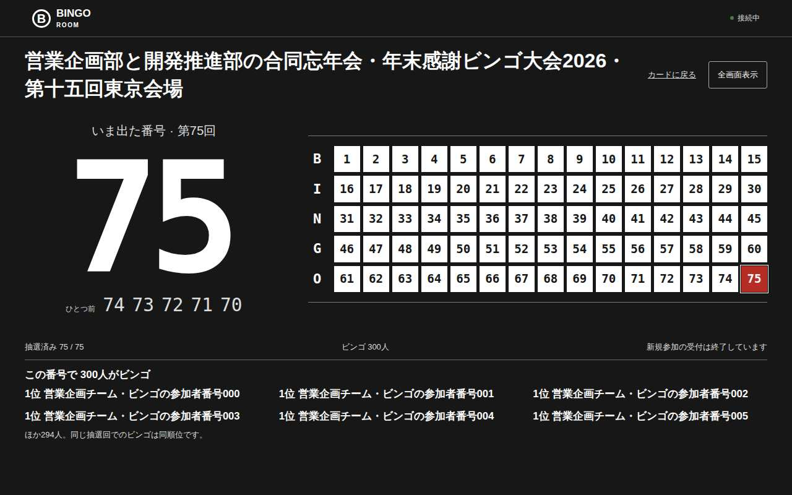
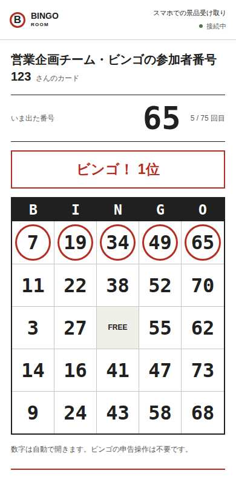

# ビンゴの進行を基準にしたデザイン

## 方針

紙のビンゴカードと抽選番号盤を出発点にする。白い紙、黒い罫線、出た番号を囲む赤丸を使い、装飾のためのグラデーション、英語の小見出し、均等な機能カード、目的のない連番を置かない。BINGOの文字・番号の固定幅書体・景品の順序はゲームで意味があるため残す。

「AIらしさ」は色や角丸の一覧ではなく、場面を理解していない画面としてレビューする。幹事が次の番号をひく、参加者が数字を確認する、会場の後方から抽選結果を見る、という作業を優先する。

## 場面ごとの判断

- トップ：参加コードを最初に置く。実際に番号をひけるサンプル、開催手順、人数別の料金表を示す。架空の利用実績・推薦文は載せない。
- 幹事の受付中：参加人数とQR、保存が必要な幹事用リンクを優先。最初の抽選で受付が閉じるため、その時だけ人数を含む確認を入れる。
- 幹事の抽選中：現在の番号、ひとつ前の番号、次の抽選を中心にする。QRとイベント設定は折りたたむ。当選結果と参加者一覧はそれぞれスクロールでき、名前で検索できる。
- 参加者：現在の抽選番号を25マスのカードの上に置く。復帰リンクはカードの下へ。リーチ・ビンゴ・景品の受け取りを明示する。回復用リンクを他人に共有しないことも示す。
- 投影：受付中は大きなQR。開始後は暗い背景に大きな番号と75個の履歴。300人が同時にビンゴしても名前は直近6人に絞り、合計人数を併記する。
- 切断時：最後のカードは残し、再接続中と操作停止を表示。正常時は同じ内容の通知を毎回表示しない。
- 印刷：背景色・画面用操作を除き、A4に2列でカードを出す。紙の手動チェックはサーバーに反映されないことを説明する。

## 敵対的レビューと検証

「初見の参加者」「スマホを片手で扱う幹事」「スクリーンから離れた客」「長い名前の参加者」「全員当選した会場」「通信切断」「キーボードのみ」「読み上げ」「印刷」の立場から確認する。好みだけで合格にしない。

Playwrightで幅320px/390px/1280pxの横はみ出し、25マスと最新番号の位置、初回抽選のキャンセル、切断時の操作停止、300人の名前検索、投影時の75番号の収まり、復帰・印刷・モーダルのフォーカス復元を検査する。Chromium/WebKitで実行し、axeでWCAG 2 A/AA・2.1 AA相当の自動検査を行う。自動検査は実会場の照明・投影距離・回線・手動読み上げの代替にはならない。

## 参考にした議論

- [NN/g: AI Prototyping in Real Design Contexts](https://www.nngroup.com/articles/ai-prototyping/)：一般的な出力と実際の作業の文脈のずれ。画面の目的と制約を具体化する。
- [NN/g: Aesthetic and Minimalist Design](https://www.nngroup.com/articles/aesthetic-minimalist-design/)：必要な情報を際立たせるために雑音を減らす。見た目の流行を目的にしない。
- [OTO dESIGN: 「AIっぽいサイト」を卒業する](https://note.com/oto_take/n/n09027101acc5)：英語の添え見出しや均等なカード等への批評を参照。ただし白・黒・赤に変えるだけでは解決しないため、各要素にビンゴでの役割を持たせる。

価格・人数・期間・sandbox制限は実装に合わせる。本販売の開始や本番規模の保証をデザイン変更だけで宣言しない。

## 追加レビューで見つけて直した点

| 観点 | 問題 | 対応 |
| --- | --- | --- |
| 進行の誤操作 | 最初の抽選で参加受付が閉じることを見落とす | 初回だけ人数と受付終了を確認。キャンセル時に抽選数が変わらないことも検査 |
| 幹事のノートPC | 番号を大きくしすぎ、次の抽選ボタンが画面の下に隠れる | 1280×720/800で操作を画面内に収める。会場向けの大きな番号は投影へ分担 |
| 会場の後方 | 現在番号・履歴・当選者を縦に積むと画面からあふれる | 現在番号と75番号盤を横に並べ、当選者6人と残り人数を下へ。40文字の題名、20文字の名前、300人同着でも720px高を検査 |
| 初めての参加者 | 復帰リンクの説明がカードより目立つ | 最新番号と25マスを最初に置き、保存用リンクはカードの後へ |
| コードでの参加 | コードだけ見せても入力先がわからない | 受付スクリーンにサイトURLを併記。トップの入力は小文字・空白を含む貼り付けからも参加できる |
| 景品の受け取り | ビンゴ後に次の行動がわからない | 順位・景品名・幹事への声かけを表示。リーチと当選後もカード全体が収まることを検査 |
| 多人数の幹事 | 300人の名簿や当選結果が画面を長く占める | 高さを制限した一覧と名前検索。キーボードでも一覧へ移動できる |
| 通信断・復帰 | 正常状態に見えたまま操作できる | 再接続中の明示と幹事操作の停止。本人カードとサーバーの番号を維持 |
| 支援技術 | 色だけで開いた番号を区別する、モーダルから焦点が消える | 赤丸の形・読み上げ用の開閉状態・フォーカス復元・高コントラスト設定を用意 |

検査用画面は架空のイベント・参加者を使う。実会場の投影距離、iOS/Android実機、読み上げソフトの手動検証は別途必要。Sitesの旧デモには、実環境の公開更新が完了するまで今回の画面変更は反映されない。

## 確認した画面

Chromiumのテスト用イベント。上の判断と操作テストに加え、実際の描画を確認した。

